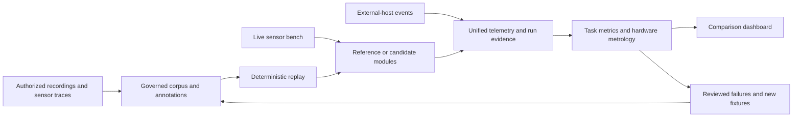

# ss-track

> The difference between "not true" and "false" is the syncretism that destroys universes.
> - Syncretism

**Building an open-source benchmark, data factory, and reference perception stack for resource-aware
object tracking on autonomous and assisted robots.**

`ss-track` is designed to make perception systems measurable before they become operational
dependencies. It will turn governed recordings, live sensor trials, external telemetry, and
eventually action-dependent simulations into reproducible tests for motion proposals, object
detection, tracking, recognition, sensor fusion, and resource-aware sensing. Its first research
stress case is a small bird of roughly 15 cm body length at investigative distances of 10–100 m;
that range is a test question, not a validated capability. Its contracts and evaluation methods are
intentionally domain-neutral: scenario packs can define birds, other wildlife, pedestrians,
scooters, vehicles, or different objects without changing the benchmark core.

The project supports a broader effort to build autonomous robots and energy-efficient cognitive
systems. In that setting, a useful perception module is one whose quality, uncertainty, latency,
memory use, and electrical cost are known under a stated workload. `ss-track` will provide the
evidence needed to choose and improve such modules, including the cases where a sensor, algorithm,
or hardware platform does not meet a requirement. The same evidence can inform a robot's sensing
policy: when to use a wide camera, when to activate a narrow view or another modality, when to run
an expensive detector, and when to return an uncertain or lost result.

The benchmark and reference modules are project goals. This description makes no measured accuracy,
range, latency, energy-saving, or field-safety claim.

## What the project is intended to deliver

- **A benchmark as a test-driven development framework.** Each capability begins with a data
  contract, deterministic fixtures, failure cases, metric definitions, and an acceptance rule. New
  algorithms are compared on identical inputs before their output is used by a larger system.
- **A governed data factory.** Source recordings and sensor traces become versioned, rights-aware
  corpora, annotations, calibration sets, replay cases, and reviewable failure slices. Derived
  datasets can support later tracking, recognition, fusion, and autonomous-system projects without
  losing their provenance.
- **Unified perception and telemetry semantics.** Local modules and external hosts report compatible
  observations, decisions, outputs, faults, timing, power, and resource measurements. The contract
  preserves source identity, time and coordinate frames, calibration, uncertainty, and the reasons
  an observation was absent.
- **A reference tracker built through TDD.** A deliberately simple, inspectable tracker will
  validate the benchmark and provide a baseline. Its later sensor-mesh form separates sensor front
  ends, fusion, track maintenance, and resource policy so each stage can be replaced and measured
  independently.
- **Platform-specific optimization with a portable baseline.** The framework will compare scalar,
  vector, and tensor implementations on named hardware and workloads. It will probe actual camera
  modes, CPU instructions, accelerators, memory, scheduling, and thermal limits before selecting a
  configuration.
- **Explicit quality–energy trade-offs.** Detection and tracking quality will be shown together with
  calibrated uncertainty, deadline misses, and measured energy. Adaptive sensor and compute policies
  will be tested against fixed baselines at matched task exposure and declared power boundaries.
- **An evidence-oriented dashboard.** Compatible runs can be compared through metric tables, curves,
  synchronized overlays, event timelines, hardware traces, and inspectable failures. Incompatible
  runs and unmeasurable quantities remain visible rather than being silently ranked.



## Benchmark-first development

The first useful result is a computer-vision-only comparison of two motion-proposal or
tracking-module versions on the same authorized video, annotations, operator-selected target boxes,
and scoring rules. The initial tracker task is class-agnostic: an operator selects an object, and
the module attempts to maintain that object's identity and location. Conditional 3-second and
10-second retention views help inspect short-term behavior, while a separate coverage measure counts
every scorable frame, including missed outputs and faults. Motion proposals are evaluated as
image-plane cues; they do not, by themselves, establish the object's physical motion or class.

Recorded operator video is valuable because it can replay actual camera motion, blur, occlusion,
clutter, and target loss. It also has a strict evidential limit: the recording contains the
operator's camera path. It can test a module's image-plane forecasts and advisory recommendations
along that path, but cannot show what would have appeared after a different drone action.
Action-dependent policy claims require a separate simulation or controlled hardware-in-loop
experiment. Field behavior requires its own scenario-specific evidence and authorization.

The planned evidence lanes make that distinction explicit:

| Lane | Main purpose | Evidence it can support |
| --- | --- | --- |
| **Offline replay** | Replay immutable recorded streams and fixed operator selections | Perception quality on the recorded view, process-local throughput and latency, conditional advisory diagnostics |
| **Controlled sensor bench** | Test real cameras and other installed sensors against an independent reference under stationary and measured motion or vibration | Device-specific sensing, timing, optical and resource behavior, plus energy when the electrical boundary is instrumented |
| **External-event integration** | Ingest outputs from another host or system through the common telemetry contract | Contract conformance and task scores when the exact input and reference can be matched; timing and power only with valid clocks and instruments |
| **Action-dependent simulation or hardware-in-loop** | Let an action change the next observation | Policy and subsystem behavior within a declared model and support region |

The delivery sequence starts with an offline pipeline and local comparison report, then adds
hardware characterization and second-host telemetry, then genuine multi-object tracking,
recognition, sensor fusion, and resource-aware policies. Closed-loop research follows only after its
observation and action model can be tested. The detailed specification defines separate acceptance
gates for these stages; a passing early fixture does not become a field-performance claim.

### Reproducible scoring

The benchmark will preserve immutable media hashes, canonical decoding rules, scenario taxonomies,
annotations, split membership, operator seeds, module and host identities, metric-suite revisions,
and the exact input/output event stream. Related frames and modalities from one encounter stay in
the same split. Development, calibration, and locked-test encounters are separated to limit leakage.
Generated blur, camera shake, dropped-frame, timestamp-skew, sensor-loss, and similar cases inherit
their source encounter and carry a versioned transform and label policy. Synthetic variants test
failure mechanisms; they are not counted as new independent field encounters.

Metrics are task-specific. Operator-seeded single-object tracking measures visible-target lock,
loss, reacquisition, identity errors, and the share of time that was actually scorable.
Motion-proposal tests distinguish target cues from moving backgrounds and camera motion. Recognition
will use class-specific labels, abstention, and calibration only when the evidence supports that
class resolution. Genuine multi-object tracking will use a pinned
[TrackEval](https://github.com/JonathonLuiten/TrackEval) adapter for appropriate MOT metrics,
including HOTA and its detection/association decomposition. TrackEval is one evaluator inside the
benchmark; the corpus, telemetry, timing, energy, and operator-seeded tracking contracts remain
native to `ss-track`.

Every result carries its numerator, denominator, exposure, uncertainty where applicable, and
validity status. A valid zero, an unsupported configuration, insufficient source truth, and energy
that was not measured are distinct outcomes. Late answers, silent skips, crashes, and confident
wrong associations cannot improve a score by removing difficult inputs from its denominator.

## A governed data factory for future projects

`ss-track` is intended to produce reusable **evidence products**, not only a leaderboard. A corpus
version should be reconstructible from its source material, rights and retention policy, sensor
inventory, calibration, clock model, annotation revisions, class ontology, encounter grouping, split
rules, and deterministic derivation recipes. A run should be reconstructible from the corpus version
plus its module, scenario, metric suite, hardware profile, and raw event trace.

The data flow is designed to support six connected activities:

1. **Acquire and register.** Import authorized video and sensor streams, retain original hashes and
   capture metadata, record their usage restrictions, and keep missing or uncertain timing explicit.
2. **Align and describe.** Build a common encounter timeline from declared clock domains, capture
   and arrival times, calibration, sensor coverage, coordinate frames, and uncertainty. Preserve the
   raw event order and original streams.
3. **Annotate and review.** Assign stable class and instance identities, visible or point-only
   geometry, occlusion and absence states, reviewer disagreement, and a frozen scoring mask.
   Fine-grained labels are used only where they can be defended.
4. **Generate controlled cases.** Produce replayable camera-motion, blur, compression, occlusion,
   stream-gap, skew, outage, and calibration-perturbation tests with known seeds and explicit label
   validity.
5. **Evaluate and mine failures.** Run interchangeable modules and store matched outputs, metrics,
   telemetry, resource traces, and frame-linked failure references. Group recurrent failures by
   object extent, environment, motion, sensor condition, and hardware profile.
6. **Publish governed derivatives.** Export authorized scenario packs, test fixtures, calibration
   sets, annotation revisions, and machine-readable run bundles with their provenance and access
   limits. Restricted media or precise locations need not be published for reproducible contracts
   and synthetic fixtures to be shared.

This data factory can feed later detector and recognizer training, cross-sensor calibration work,
hardware selection, regression tests for onboard software, controlled policy research, and
post-incident failure analysis. It can also supply a common evidence layer for other robotic
platforms: a new project defines its scenario classes, sensors, operating constraints, and metrics
while reusing the encounter, telemetry, replay, provenance, and measurement machinery. New use cases
do not inherit a score or safety claim from the original small-object scenario.

The factory's reusable outputs can include a source manifest, reviewed and split corpus, calibration
set, fixed-input observation bundle, deterministic fault fixture, hardware trial, scored run bundle,
and a small failure pack that another developer can replay. Each output carries its parent hashes
and rights. A public fixture can therefore verify event parsing or an algorithmic edge case even
when the original field video remains private.

Candidate scenario packs illustrate how the same foundation could serve other projects:

| Scenario | Example evidence and evaluation question |
| --- | --- |
| Conservation observation and mobile wildlife surveys | Wide/narrow video, optional acoustic or thermal evidence; small-target recall, track retention, false alarms, and disturbance-aware collection rules |
| Roadside pedestrian and micromobility perception | Camera and, where installed, radar or event sensors; identity continuity through occlusion, warning latency, and privacy-preserving data products |
| Service robots and shared spaces | Camera, depth, IMU and proximity observations; safe-distance state estimates, re-entry after occlusion, and sustained on-device deadline behavior |
| Infrastructure and corridor inspection | Repeated mobile-camera passes and position context; consistent object association, change candidates, and repeatability across lighting and platform motion |
| Low-power fixed-site monitoring | Intermittent camera, audio or presence triggers; detection at a fixed false-alarm burden versus complete sensor-plus-compute joules |
| Multi-robot or fleet research | Time-aligned observations and host telemetry; cross-device evidence quality, availability, transfer and energy budgets without assuming a shared tracker identity |

Each pack must define its own annotation ontology, sampling frame, privacy and collection rules,
feasible sensors, and operating limits. Protected habitats and identifiable people require
particular care in the source and public derivatives. These examples describe possible evaluation
domains, not validated deployments.

## Unified telemetry across modules and hosts

The telemetry contract will describe **what happened**, independently of whether a module runs as a
Python process, a C++20 executable, a Raspberry Pi service, a Rockchip module, or another external
system. Versioned protobuf schemas define event semantics from the start. The initial replay path
uses staged frame bundles and protobuf-JSON-mapped JSON Lines for inspectable per-frame results;
binary framing can be added when an onboard or second-host path requires it. High-rate video, audio,
radar, and similar samples remain in versioned data bundles and are referenced by events rather than
copied into each telemetry record.

Core record families cover run and frame identity, target selection, detections, tracks, advisory
actions, sensor samples, resource and power samples, hardware trials, validation, and faults. Later
fusion records describe typed sensor observations, epoch schedules, fused results, tracker results,
acquisition decisions, and budget state. The contract preserves:

- source hashes, stream/frame/event IDs, class and track IDs, schema and module versions;
- media presentation time, capture interval, driver or receive time, processing time, publication
  time, clock domain, alignment error, and timestamp quality;
- coordinates, units, calibrated transforms, field of regard, observation geometry, and uncertainty
  type;
- every contributing source and its correlation group, so duplicated or derived evidence is not
  mistaken for independent support;
- the difference between a valid `no_detection`, `out_of_view`, `disabled_by_policy`, `missing`,
  `stale`, and `invalid` source state;
- explicit frame or epoch acknowledgments, including valid empty outputs, abstention, late results,
  and faults;
- the chosen compute variant, actual backend or instruction path, scheduler profile, measured
  resources, electrical boundary, and evidence quality.

This common language makes an external implementation scoreable without forcing its internal
architecture or transport onto the benchmark. Cross-language fixtures and versioned adapters will
check Python and C++20 interpretations of units, geometry, time, identity, and fault semantics.
Interoperability with [ss-common](https://github.com/volod/ss-common) contracts can be provided
through explicit, versioned mappings; the benchmark's event types will still need to carry its
scoring and measurement semantics.

## A TDD reference tracker on a heterogeneous sensor mesh

The **sensor mesh** in `ss-track` is a logical graph of heterogeneous observation sources and
processing stages. It describes which sensor produced an event, when that event was available, where
it could observe, how it was calibrated, and how its evidence contributed to a result. It does not
require a particular radio or network topology. A networked sensor source, including one from
[ss-sens](https://github.com/volod/ss-sens), can enter through an adapter when its clocks,
provenance, and operating modes meet the benchmark contract.

The first reference path uses one camera and a fixed operator-provided box. A bounded motion or
object proposal supplies a measurement; an image-plane constant-velocity Kalman model predicts the
next location; deterministic geometry and uncertainty gates choose an admissible match; explicit
tentative, confirmed, lost, and reacquired states account for continuity. When no credible
observation is available, the tracker acknowledges the frame and emits `lost`; calibrated
track-existence uncertainty can be added after a separate calibration suite supports it. The
reference is an executable baseline for tests and comparisons, not an accuracy ceiling.

The later multi-sensor path separates **front ends → typed observations → event-time fusion → track
maintenance → optional resource policy**. A transparent late-fusion baseline uses bounded
reordering, clock and geometry checks, provenance-aware association and deduplication, and
calibrated evidence for object existence. It treats an active, healthy sensor's valid negative
observation differently from an unavailable or deliberately disabled sensor. Track maintenance
consumes the same fixed observation bundle and epoch schedule as every candidate tracker. More
advanced Kalman, extended/unscented, particle, JPDA, multi-hypothesis, or learned methods can be
added behind those contracts when a scenario provides the labels and calibration needed to evaluate
them.

Possible inputs include visible wide- and narrow-field cameras, calibrated stereo, event or thermal
imaging, microphone arrays, radar, lidar or time-of-flight, short-range presence and contact
sensors, and cooperative tags where the subject is instrumented. IMU, pose, motor, light, wind, and
temperature signals can explain ego-motion and sensing conditions. They are not independent
sightings of an object. Every modality has its own range, coverage, clock, privacy, energy, and
validation limits; listing a modality never implies it can identify or track a small object at a
specified distance.

TDD fixtures will force failures to be explicit: target absence, camera shake, look-alike crossings,
short occlusions, re-entry, wide/narrow switching, timestamp skew, duplicate or correlated
observations, stale calibration, source loss, contradictory sensors, missed deadlines, and exhausted
energy budgets. Each fixture states the expected acknowledgment count, source lineage, allowed state
transitions, and metric accounting. A candidate must pass conformance fixtures and then show its
task-level value on paired encounters.

## Measure components and the installed system separately

To avoid attributing a system-level gain to the wrong component, expanded evaluations use four
distinct boundaries:

| Boundary | What is allowed to vary | What is learned |
| --- | --- | --- |
| **Sensor set and front ends** | Installed sensor subsets or their adapters under one fixed reference fusion rule | Which sources provide usable evidence, at what false-alarm burden, delay, and coverage; stage-local cost only where separately metered |
| **Fixed-observation fusion** | Fusion algorithm on an identical, hashed observation bundle | Association, deduplication, calibrated existence/class evidence, uncertainty, and fusion-stage cost |
| **Fixed-observation tracker** | Track-maintenance algorithm on an identical observation stream and schedule | Identity continuity, loss/re-entry, prediction, calibration, deadline behavior, and tracker-stage cost |
| **Full installed system** | The complete capture-to-output configuration and policy under matched task opportunities | End-to-end quality, timing, availability, and measured installed-system energy |

The dashboard will keep these views separate. It will compare only compatible corpus, label, input,
metric, hardware, and measurement cohorts. A component can be excellent in isolation while the
installed system fails due to capture, clock alignment, transport, thermal limits, or resource
policy; the benchmark must show both results.

## Platform-specific optimization and real-time evidence

Python will be the primary stack for corpus preparation, orchestration, evaluation, and the
dashboard. C++20 will be used for onboard paths whose measured deadline, memory, or energy budgets
justify it. The benchmark will start from portable behavior and make each optimized path an
identified, independently testable variant. A hardware-probe module will inspect the installed
sensors and their **simultaneous sustainable modes**, CPU and OS-enabled instruction features,
available memory and I/O, accelerators, scheduler and kernel profile, temperature and throttling,
and the supported tensor operations and shapes. It will select only a configuration whose declared
constraints pass bounded capability trials, or return an explicit unsupported or
measurement-required result.

For hand-written onboard C++20 kernels, a scalar implementation provides a correctness reference.
Candidate optimizations include fewer full-frame passes, bounded regions of interest, cache-aware
layouts, fixed memory budgets, and Arm Neon kernels on suitable Raspberry Pi profiles. SVE/SVE2, Arm
matrix or dot-product extensions, x86 SIMD/AMX, and RISC-V Vector are candidates only on hosts whose
CPU **and operating system** expose the required state. Vector-length, tail, alignment, saturation,
and floating-point behavior receive explicit fixtures. A host must be able to use its portable
fallback without executing an unsupported instruction.

Tensor models can use a pinned CPU execution as their graph reference and optional GPU, NPU, FPGA,
or CPU-tensor backends where available. The framework will record the actual model and precision,
graph partition, transfers, compilation state, driver and firmware, CPU fallback, and end-to-end
latency. A detected accelerator is not evidence that a graph ran on it. Accuracy-equivalence and
faster-or-cheaper claims require numerical conformance where applicable, paired task-level quality,
and valid measurements for each claimed latency, memory, or energy advantage.

Raspberry Pi 5 is an initial host profile; constrained Raspberry Pi Zero and Raspberry ↔ Rockchip
combinations are later targets. A wide camera can supply broad motion proposals while a narrow
camera supplies more pixels on a selected object, but the gain depends on alignment, field of view,
blur, synchronization, and processing cost. Early camera tests use fixed mounts and can replay
movement or measured vibration on a bench. Linux real-time configurations, including PREEMPT_RT
where available, are measured as named scheduler profiles; they do not imply a hard deadline for an
unmeasured camera or accelerator path.

| Platform profile | Optimization questions to measure |
| --- | --- |
| **Raspberry Pi 5** | Sustainable one- and two-camera modes, Arm Neon versus scalar kernels, ROI size, memory bandwidth, CPU placement, thermal behavior, and measured full-system joules |
| **Raspberry Pi Zero family** | Exact board/CPU capabilities, smaller input and state budgets, bounded acquisition and continuity paths, and whether an optimized variant actually improves deadlines or energy |
| **Raspberry Pi ↔ Rockchip split** | Which stage belongs on each host, transfer and synchronization cost, available accelerator graph coverage, fallback, and combined installed-system energy |
| **x86-64 development or edge host** | Scalar versus supported SSE/AVX or matrix paths, concurrent stream capacity, memory/I/O pressure, and controlled cross-variant comparisons |
| **Other Arm or RISC-V hosts** | Actual OS-enabled Neon/SVE or RISC-V Vector capabilities, vector-length-safe code, and workload-specific quality–cost results |

Hardware reports will use versioned trials and independent references. Depending on the claim, they
will measure delivered optical detail and target pixel extent, frame cadence and drops, clock
alignment, stage and end-to-end latency, CPU and memory pressure, I/O, thermal and throttling
behavior, vibration, and electrical power. Calibrated voltage/current or power samples are
integrated over the exact marked interval to obtain joules, with instrument bandwidth, gaps,
uncertainty, and a fixed electrical boundary retained. CPU utilization or a datasheet power value is
diagnostic, not a substitute for measured energy.

## Managing quality, uncertainty, and energy budgets

A resource policy may select the sensor subset and mode, camera region and rate, full re-detection
or inexpensive track update, recognition step, model/backend/precision, or a bounded defer/skip
action. It may use only the context available **before** the choice: previous track uncertainty,
sensor health, queue load, thermal state, predicted observability, and the remaining budget. Its
event records predicted quality gain or loss, latency, joules, risk, feasible actions, and the
chosen action; later measurements record what actually happened.

The initial adaptive comparator can use a transparent event trigger and a calibrated, one-step
**value of information** estimate. More elaborate budgeted or learned policies can follow behind the
same contract. All policies are evaluated against feasible always-on, fixed-rate, fixed-subset, and
seeded random-skip baselines on the same task exposure. The objective is a declared quality target
at a fixed false-alarm burden, under hard deadline, peak-power, memory/bandwidth, thermal, and
rolling-energy limits. Abstaining or skipping a hard case does not remove it from the quality
denominator.

Reports will expose a quality–latency–energy frontier rather than a single opaque score. Energy
saved by physically disabling a sensor can be claimed only when the installed system, including
sensor wake, transport, and compute, is measured at the same electrical boundary in both compared
trials. Suppressing an already recorded stream during offline replay is a valid input-ablation
experiment; it does not measure physical sensor-off savings.

## Connection to related open-source work

`ss-track` is intended to interoperate with other projects in the [volod
repositories](https://github.com/volod?tab=repositories) through explicit contracts and adapters. A
repository relationship does not, by itself, imply a runtime dependency.

| Project | Relevant role for `ss-track` |
| --- | --- |
| [ss-common](https://github.com/volod/ss-common) | Shared contract and lightweight runtime work; a possible interoperability layer for versioned observation and telemetry mappings |
| [ss-sens](https://github.com/volod/ss-sens) | Networked sensor events and an edge sensor mesh; a candidate external source for aligned benchmark observations |
| [ss-fusion](https://github.com/volod/ss-fusion) | Perception and fusion research; candidate interchangeable modules or whole systems to evaluate |
| [ss-video](https://github.com/volod/ss-video) | Video ingestion and search; a possible source of recorded video and metadata for governed corpus import |
| [drau](https://github.com/volod/drau) | Acoustic drone-detection test harness; a possible source of modality-specific methods and evaluation cases |
| [loc-lm-bench](https://github.com/volod/loc-lm-bench) | Evidence-first benchmarking and gated robotics evaluation methodology; no LLM is required for the core tracker |
| [fl-op](https://github.com/volod/fl-op) | Fleet and mission-level resource optimization; perception-energy evidence could inform higher-level decisions |
| [agent-py](https://github.com/volod/agent-py) and [agent-cpp](https://github.com/volod/agent-cpp) | Documentation and agent-development workflow for the Python framework and possible C++20 onboard modules |

At a broader systems level, `ss-track` can serve as the **perception and measurement layer** in an
autonomy evidence loop: scenario and operational constraints → sensor and compute configuration →
observations and calibrated uncertainty → decisions → measured outcome or failure → replayable test
case. A future robot runtime or operations platform can consume its versioned evidence without
making the benchmark itself a vehicle controller.

## Responsible use and open development

The project should make research repeatable while respecting the people, animals, sites, and data
involved. Scenario packs carry collection rights, retention and sharing rules, privacy requirements,
operational limits, and stop criteria. Public data derivatives may omit raw footage and redact or
coarsen sensitive locations and identifiers. Recorded footage of a protected subject is a source of
conditional perception evidence, not an invitation to reproduce its capture conditions. Bench tests
can use controlled, non-sensitive targets before any new field study.

The open-source contribution path is evidence-driven: propose a scenario, sensor adapter, algorithm,
metric, or hardware optimization together with its data contract, a positive and negative fixture, a
reproducible evaluation, and its known limits. The [project specification](docs/design/spec.md)
defines the product and acceptance rules; the [forward implementation plan](docs/impl/plan.md) and
[current-state documentation](docs/impl/current.md) follow the [agent-py documentation
model](https://github.com/volod/agent-py/blob/main/docs/README.md). This structure is intended to
help human and coding-agent contributors build a benchmark whose measurements remain useful as the
supported robots, sensors, domains, and compute platforms grow.

## Development

The benchmark capabilities above are planned. Today the repository provides the locked Python
package, the `ss-track` command, and the quality and planning infrastructure they will be built on.

### Quick start

Requirements: Git, Make, and [uv](https://docs.astral.sh/uv/).

```bash
git clone git@github.com:volod/ss-track.git
cd ss-track
make bootstrap
make run
make ci
```

`make bootstrap` creates `.venv` from the committed lockfile. `make run` exercises the `ss-track`
CLI. `make ci` runs the same required checks as GitHub Actions.

Do not put product work directly into the plan before the specification describes its capability
and evaluation. The workflow is explained in
[Planning workflow](docs/guide/planning-workflow.md).

### Daily commands

| Command | Purpose |
| --- | --- |
| `make help` | List supported workflows |
| `make bootstrap` | Create or update the locked development environment |
| `make run` | Run the project identity command |
| `make test` | Run the unit test suite |
| `make coverage` | Run tests with the coverage gate |
| `make format` | Apply Ruff formatting |
| `make ci` | Run required local and CI checks |
| `make quality` | Run CI checks, coverage, Markdown lint, and package build |
| `make plan-status` | Count tasks and show the next agent and human work |
| `make lint-spec-plan` | Check the capability registry against the plan |
| `make lint-doc-links` | Check relative Markdown files and anchors |
| `make quality-report` | Report files over the soft size limit |

Use Make targets for repeatable workflows. Direct `uv` debugging should first source
`scripts/shared/common.sh` and run `sst_load_env` so cache and link behavior follows `.env`.

### Documentation model

```text
docs/design/spec.md        what the product must do and how each capability is evaluated
          |
          v
docs/impl/plan.md          only work that remains, ordered by capability
          |
          v
docs/impl/current.md       index of behavior that exists now
```

The specification is living, not a fixed scope fence. A newly discovered product need enters the
specification first, including its boundary and negative-result rule. It then receives a `planned`
registry row and plan tasks. When the capability lands, its implementation moves out of the plan
and into the narrowest current-state page, and the registry row becomes `shipped`.

### Agent support

`AGENTS.md` is the canonical policy. `CLAUDE.md`, `GEMINI.md`, `.codex`, and the Cursor rule are
thin adapters that point to it. Keeping substantive rules in one file prevents tool-specific drift.

### Layout

```text
src/ss_track/              production package
tests/                     unit and governance tests
docs/design/               product specification
docs/impl/plan.md          forward-only work
docs/impl/current/         delivered behavior
docs/guide/                contributor workflows
scripts/shared/            shared shell environment helpers
.github/workflows/         required CI
```

Runtime output belongs under `$DATA_DIR/<method>/<run-id>/`, which defaults to `.data/` and is
ignored by Git.

## License

MIT. See [LICENSE](LICENSE).
